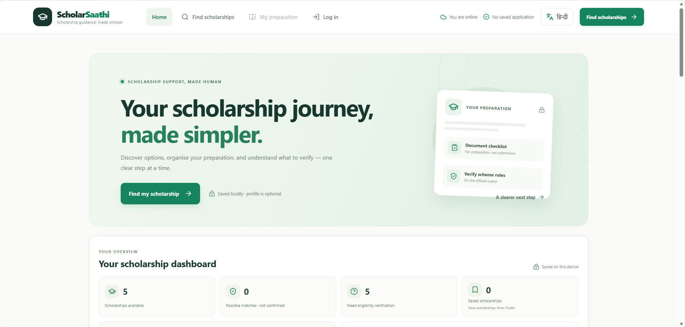
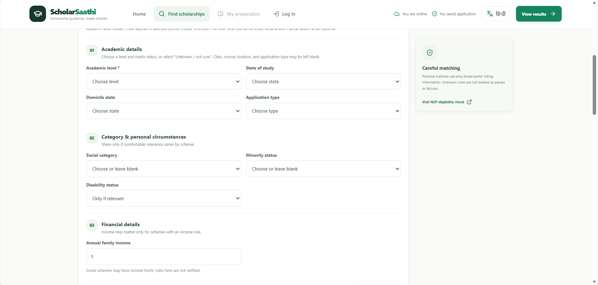
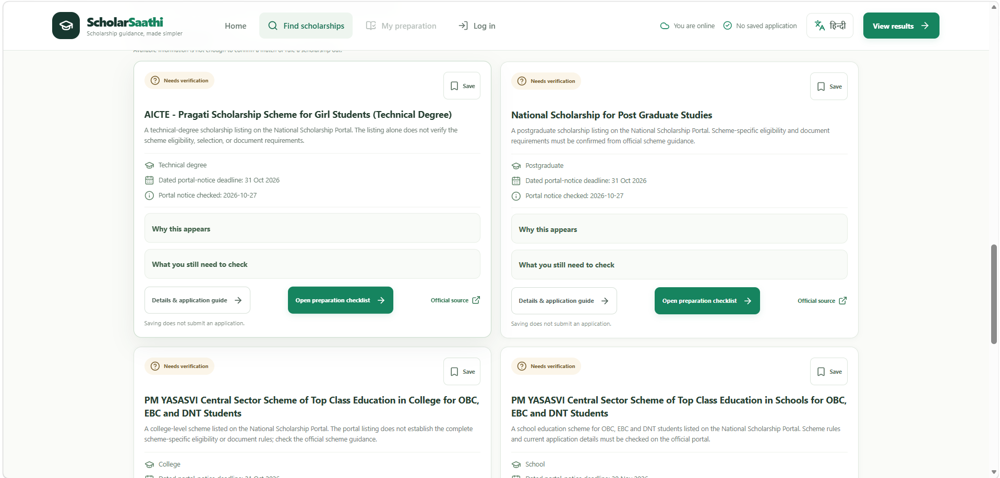

# ScholarSaathi

### Discover scholarships. Prepare with confidence. Take the next step.

ScholarSaathi is a student-focused platform designed to simplify scholarship discovery and application preparation in India. It helps students explore opportunities, understand potential eligibility, identify preparation needs, and track their progress toward applying.

**React · TypeScript · Vite · IndexedDB · Responsive UI**

[▶ Open the Demo](#demo) · [⚙ Quickstart](#quickstart) · [✨ Features](#features) · [🛠 Tech Stack](#tech-stack)

---

## The Problem

Finding a scholarship is only the beginning.

Students often struggle to understand eligibility requirements, identify the right documents, navigate application instructions, and keep track of the steps required before applying. Information scattered across different portals can make the process confusing, especially for students without access to personalized guidance.

ScholarSaathi aims to bridge the gap between **discovering a scholarship and preparing to apply for it**.

## Our Solution

ScholarSaathi brings scholarship discovery and preparation into one organized workflow:

**Discover → Understand → Prepare → Track → Apply**

- **Discover:** Explore scholarship opportunities in one place.
- **Understand:** Review eligibility information and identify criteria that need verification.
- **Prepare:** Organize documents and follow available preparation guidance.
- **Track:** Save scholarships and monitor preparation progress.
- **Apply:** Access the official application portal and follow its instructions.

ScholarSaathi supports students in preparing their applications. It does not guarantee eligibility, scholarship approval, or successful submission.

## Demo

Open the application locally to explore the current prototype.

**Demo status:** Local prototype.

Once a public demo is deployed, add its URL here.

- **Live demo:** [Add deployed demo URL]
- **GitHub repository:** [Add your repository URL]
- **Demo video:** [Add your video URL, if available]

### What to explore

1. Open the home dashboard.
2. Enter academic and student profile information.
3. Explore scholarships using the Scholarship Finder.
4. Review potential matches and eligibility explanations.
5. Save a scholarship for later.
6. Explore preparation progress and recommended next steps.

The exact guidance available for each scholarship depends on the information verified and implemented for that record.

## Features

### 1. Scholarship Finder

Explore available scholarship records through a dedicated discovery interface.

- Search and filter scholarships.
- Review potential eligibility matches.
- Identify scholarships requiring further verification.
- Save and unsave scholarships.
- Access explanations of matching results.

### 2. Student Profile

Use academic and other relevant profile information to support scholarship matching.

- Academic level and marks.
- Relevant student and application details.
- Input validation for marks.
- Explicit handling of unknown information.
- Local profile persistence.

Eligibility matching treats unknown information cautiously instead of automatically assuming that a student qualifies.

### 3. Personalized Dashboard

View important scholarship and preparation information in one place.

- Scholarship counts derived from the current dataset.
- Possible matches and items requiring verification.
- Saved scholarship count.
- Preparation progress and remaining tasks.
- Context-aware next-step recommendations.
- Resume actions for unfinished preparation.

### 4. Preparation Tracking

Keep track of progress through the existing preparation workflow.

- Review outstanding tasks.
- Track answered preparation questions and ready items.
- Resume unfinished work.
- View updated progress on the dashboard.

Scholarship-specific document checklists and form-filling instructions should be presented as verified guidance only where they have actually been implemented and checked against reliable sources.

### 5. English and Hindi Support

The interface supports English and Hindi to make scholarship information easier to navigate for more students.

### 6. Privacy-Conscious Local Storage

Supported profile, saved scholarship, and preparation data can be stored locally in the browser.

Local browser storage is not encrypted by default. Avoid entering sensitive information on shared or untrusted devices.

### 7. Responsive Interface

The application is designed to support desktop and mobile screen sizes, with accessible form controls and responsive layouts.

## Tech Stack

| Technology | Purpose |
|---|---|
| React | User interface |
| TypeScript | Type-safe application development |
| Vite | Development server and production build |
| CSS | Responsive styling and interface design |
| IndexedDB | Local persistence for preparation, finder profile, and saved scholarship data |
| Service Worker | Caches the application shell and same-origin assets for limited offline use |
| Supabase Auth | Optional email/password authentication when configured; profile and saved-scholarship cloud sync are not implemented |

## Quickstart

### Prerequisites

- Node.js and npm
- Git
- A modern web browser

### 1. Clone the repository

Replace the example URL with your actual GitHub repository URL.

```bash
git clone https://github.com/Nomee-123/ScholarSaathi.git
cd ScholarSaathi
```

### 2. Install dependencies

```bash
npm install
```

### 3. Configure environment variables

The app runs in guest mode without environment variables. Supabase email/password authentication is optional and disabled until configured. To enable it, copy `.env.example` to `.env.local`:

```powershell
Copy-Item .env.example .env.local
```

Set `VITE_SUPABASE_URL` to your Supabase project URL and `VITE_SUPABASE_ANON_KEY` to its publishable key (or legacy anon key). These `VITE_` values are included in browser code; use only the public key, never a secret or `service_role` key. Keep `.env.local` local and do not commit it. For provider and redirect setup, see [supabase/SETUP.md](supabase/SETUP.md).

Without both valid values, authentication remains unavailable while local guest features continue to work. Authentication does not enable cloud profile or saved-scholarship synchronization.

### 4. Start the development server

```bash
npm run dev
```

Open the local URL printed by Vite in your terminal. It is commonly:

```text
http://localhost:5173
```

### 5. Run available checks

The project has no automated test script or automated test files. Run the available lint and production build checks:

```bash
npm run lint
npm run build
```

A successful build confirms that the project compiles; neither command exercises user interactions or external integrations. See [docs/TEST_CASES.md](docs/TEST_CASES.md) for manual test cases, which have not been executed automatically.

The sample scholarship records are in [sample-data/scholarships.json](sample-data/scholarships.json). They mirror the current application data for development and testing; they are not an independently verified or current source of scholarship requirements or deadlines. See [docs/TECHNICAL_DESIGN.md](docs/TECHNICAL_DESIGN.md) for the implemented architecture.

## Dashboard




## How It Works

### Application Flow

```text
Student
   |
   v
Student Profile
   |
   v
Scholarship Finder
   |
   v
Eligibility Matching
   |
   v
Scholarship Details
   |
   v
Preparation Workflow
   |
   v
Progress Tracking
   |
   v
Official Application Portal
```
## Preparation workflow



### Eligibility and Data Integrity

ScholarSaathi distinguishes between potential matches and verified eligibility.

- Verified criteria can be evaluated against known student information.
- Unknown criteria remain unknown.
- Missing information must not be treated as proof of eligibility.
- Official scholarship sources should be used to verify requirements and deadlines.
- Students should confirm current requirements on the official application portal before applying.

This approach helps reduce misleading eligibility claims.

## Working prototype



## Expected Impact

ScholarSaathi aims to make scholarship discovery and preparation more understandable and organized.

Its intended impact includes:

- Reducing confusion around scholarship eligibility and application preparation.
- Helping students identify documents and preparation tasks.
- Making scholarship information easier to navigate.
- Encouraging students to take informed next steps.
- Supporting access to educational financial assistance, particularly for students from low-income and rural backgrounds.

### United Nations Sustainable Development Goals

- **SDG 4 — Quality Education:** Supporting access to educational opportunities.
- **SDG 10 — Reduced Inequalities:** Helping students navigate scholarship information and financial-support opportunities.

These are intended areas of impact, not claims of measured outcomes.

## Limitations

- Scholarship coverage depends on the records currently included in the dataset.
- Scholarship notices and deadlines can change.
- Some eligibility criteria may require further verification.
- Guidance must not be presented as official advice unless supported by a reliable source.
- The prototype does not guarantee eligibility, award approval, or application submission.
- Local browser data may be lost if the browser's site data is cleared.
- Offline support depends on the implemented service-worker caching behavior.
- Authentication and cloud synchronization should be considered available only after real configuration and testing.

## Future Improvements

Potential next steps include:

- Expanding the verified scholarship database.
- Adding scholarship-specific document checklists.
- Providing verified, step-by-step application form guidance.
- Improving official-source and deadline verification.
- Completing secure authentication and cross-device synchronization.
- Conducting broader usability and accessibility testing.
- Deploying a public demo for students and hackathon judges.

## Contributing

Contributions and suggestions are welcome.

1. Fork the repository.
2. Create a feature branch.
3. Make focused changes.
4. Run the available checks:

   ```bash
   npm run lint
   npm run build
   ```

5. Submit a pull request describing your changes.

Please preserve cautious eligibility matching and do not add unverified scholarship requirements, deadlines, or documents as facts.

## Project Status

ScholarSaathi is an evolving prototype. Its purpose is to help students move beyond finding a scholarship and toward understanding and preparing for the application process.

**Discover opportunities. Understand requirements. Prepare for your future.**

## License

Original ScholarSaathi project code is licensed under the MIT License; see [LICENSE](LICENSE). Third-party components, dependencies, and assets remain subject to their respective licenses and are not relicensed by this project license.
